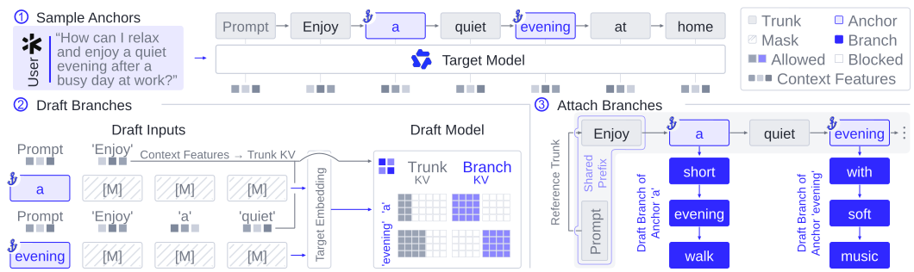
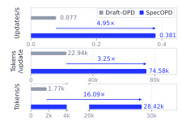
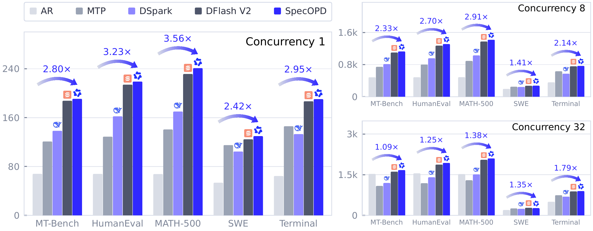

  <picture>
    <source media="(max-width: 640px)" srcset="assets/github-cover-complete-mobile-v2.png">
    
  </picture>

Read the prologue · Text version / 阅读序言 · 文字版

**English**

**Paths diverge. Thought goes on.**

In Borges’s The Garden of Forking Paths, a story holds many possible futures. At each fork, the paths not taken continue elsewhere, toward other encounters and endings. The paths drift apart. A stretch of their journey remains shared.

Kieślowski places the fork at a station. In Blind Chance, a young man runs for a departing train. A few seconds open into three lives. We watch the same person enter different years, and remember something we once caught—or failed to catch—in time.

We can turn back a page, watch a film again. Those different futures bring the moment before the fork into focus: when everything was still on the same path.

Can paths with a shared beginning move forward together?

Language, too, keeps arriving at such forks. A passage already written can lead to different next sentences. SpecOPD samples draft continuations at different points in existing text, allowing branches to receive feedback from the target model in parallel. They reuse computation for their shared context, retain their own sampled histories, and learn to draft better through parallel training. The shared path need not be retraced for every branch.

The person waiting for an answer has unfinished thoughts of their own. A book half read. A sentence revised again and again. A thought just taking shape, still searching for words. Sometimes we pause to think more clearly; sometimes we are simply waiting for the next line on the screen.

We hope to shorten that wait, so reading, writing, and questioning can continue.

*Let one thought arrive in time to meet the next.*

**中文**

**小径分岔， 思绪未竟。**

在博尔赫斯的《小径分岔的花园》中，一个故事容得下许多种后来。走到岔路时，未被选择的可能仍在别处延续，通向不同的相遇与结局。小径渐行渐远，却有一段共同的来路。

基耶斯洛夫斯基把分岔放在了一座车站。《机遇之歌》里，一个年轻人奔向即将离开的火车。几秒钟的差异，展开了三种人生。我们看着同一个人走入不同的岁月，也想起曾经赶上、或没能赶上的什么。

书页可以翻回，电影可以重看。不同的后来，让分岔前的片刻变得清晰：一切还在同一条路上。

拥有共同来处的小径，能否一起向前延伸？

语言也不断抵达这样的岔口。一段已经写下的文字，可以通向不同的下一句。SpecOPD 从已有文本的不同位置展开草稿，让多条延续同时接受目标模型的反馈。它们复用共同前文的计算，各自保留新生成的历史，在并行训练中改善起草能力。共同的来路，不必为每条分支重新走过。

而等待回答的人，也有尚未走完的思绪。一本读到一半的书，一句改了又改的话，一个刚刚浮现、还没有找到措辞的念头。有时，我们停下来，是为了想得更清楚；有时，只是在等屏幕上的下一行。

我们希望这样的等待能短一些。答案到来，阅读、写作与追问便能继续。

*让一个念头，来得及接住下一个。*

Literary sources: Jorge Luis Borges, *The Garden of Forking Paths*; Krzysztof Kieślowski, [*Blind Chance*](https://www.criterion.com/current/posts/3706-blind-chance-the-conditional-mood).

Visual reference: [Gérard DuBois / Criterion](https://www.criterion.com/current/posts/3722-blind-chance-by-gerard-dubois).

---

# SpecOPD
### Branch-Parallel On-Policy Distillation for Speculative Decoding

**Faster lossless decoding through elegant, efficient branch-parallel on-policy learning.**

[Overview](#overview) · [Video](#video) · [How It Works](#how-it-works) · [Results](#results) · [Release Status](#release-status)

## Overview

SpecOPD trains parallel draft models to propose tokens that the target model accepts more often. It makes on-policy distillation efficient by collecting draft samples and target supervision across independent branches in parallel.

The key insight is simple: **a draft block needs its reference prefix and its own sampled history for on-policy supervision.** Training does not require collecting a complete response through sequential draft-and-verify rounds. SpecOPD samples branches from the current drafter at reference anchors, shares target-prefix computation, and optimizes acceptance length with an E2E-TV objective.

| Better draft quality | Faster training | Faster decoding |
| :---: | :---: | :---: |
| **Up to 41.45%** higher mean acceptance length | **16.09×** supervised-token throughput | **Up to 3.56×** generation speedup |
| Over the original drafter, averaged across five benchmarks | Over sequential-rollout OPD on 27B / DFlash V2 | Over autoregressive decoding on the same GPU |

## Video

https://github.com/user-attachments/assets/a09417e5-7cc4-47d9-961a-539fc3d4dfd7

## How It Works

  

1. **Sample reference anchors.** Choose positions along reference responses to provide contexts for training.
2. **Draft independent branches.** Sample continuations from the evolving draft policy at each anchor in parallel.
3. **Score with shared prefixes.** Pack branches into proposal trees and reuse target computation while preserving each branch's own history.
4. **Optimize acceptance length.** Train with an E2E-TV surrogate based on draft–target distribution overlap along sampled branches.

SpecOPD preserves branch histories across three attention mechanisms:

| Target attention | Branch-parallel execution |
| --- | --- |
| Full attention (GQA) | Share trunk KV and use tree masks to isolate branch histories. |
| Sparse attention (QSA) | Maintain branch-consistent compressed indexer groups after divergence. |
| Linear attention (GDN) | Restore anchor states from shared checkpoints and advance branches with indexed state replay. |

## Results

### Evaluation coverage

The study covers **three target scales**, **three parallel draft architectures**, and **four task domains**, with greedy decoding (`T = 0`) and sampling (`T = 1`).

| Target | Attention | Draft models |
| --- | --- | --- |
| Qwen3-8B | Full | DFlash, DSpark |
| Qwen3.8-27B | Full + linear | DFlash V2 |
| Qwen3.8-Flash-Next-125B | Sparse + linear | DFlash V2 |

Benchmarks span dialogue (**MT-Bench**), coding (**HumanEval**), mathematics (**MATH-500**), and agentic contexts (**SWE** and **Terminal**). Agentic measurements evaluate decoding on recorded histories. Acceptance length (AL) counts completion tokens per verification round, including bonus tokens; benchmark means receive equal weight.

SpecOPD improves five-benchmark mean AL by up to **41.45%**, with an agentic-task AL gain of up to **81.51%**. Mean-AL gains reach **3.48%** on 27B and **5.01%** on 125B.

### Training efficiency

  

On Qwen3.8-27B / DFlash V2 with eight high-performance GPUs, branch parallelism combines faster updates with more supervision per update:

| Metric | SpecOPD / sequential-rollout OPD |
| --- | ---: |
| Optimizer updates per second | **4.95×** |
| Supervised tokens per update | **3.25×** |
| Supervised tokens per second | **16.09×** |

Tokens count only predictions contributing to the training loss. Measurements use each method's evaluated training configuration and exclude offline reference preparation.

### Inference efficiency

  

Measured generation speedup reaches **3.56× over autoregressive decoding** on Qwen3.8-27B, using BF16, TP = 1, FlashAttention-3, and CUDA Graphs. The figure compares output throughput at concurrency 1, 8, and 32; speedups vary with workload and concurrency.

### On-policy learning matters

At matched optimizer steps and reference-sequence batches, SpecOPD improves mean AL by up to **15.71% over off-policy E2E-TV** and **6.96% over off-policy cross-entropy**. Its best evaluated checkpoint improves accepted-prefix survival at all seven draft positions, with a **4.33 percentage-point** gain at position seven.

## Release Status

This initial repository contains the project overview and selected figures. Training code, evaluation scripts, and model weights are not included in this initial release.

## Acknowledgments

We thank Jue Wang and Yubo Wang at LightSeek Foundation and the vLLM team for feedback and support.

SpecOPD builds on parallel draft models including DFlash, DSpark, and DFlash V2. The inference comparison includes their original configurations as baselines.
